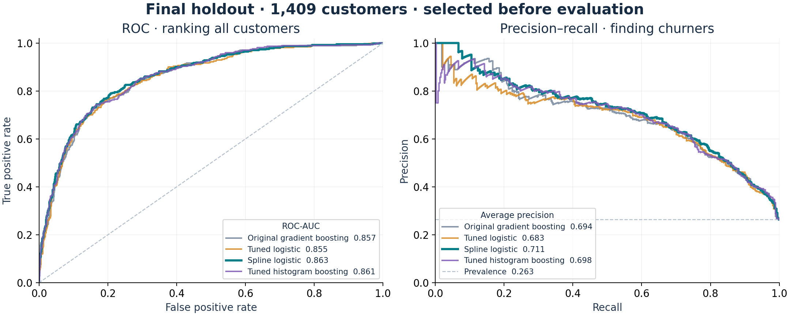
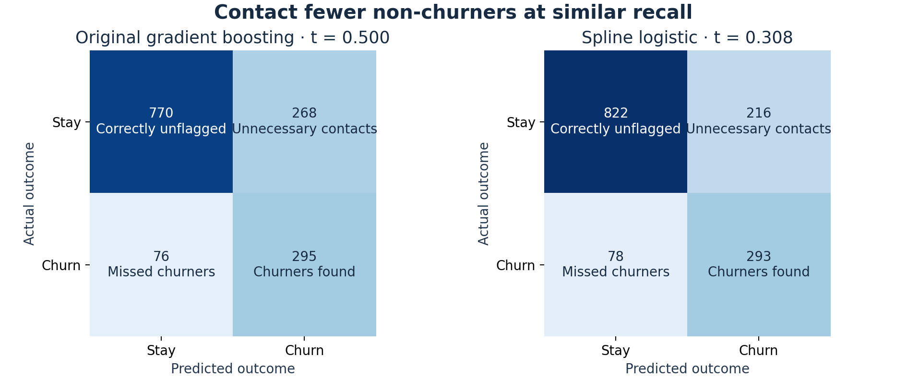
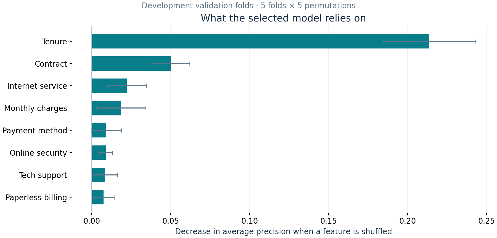

# Customer Churn Prediction

**Prioritize retention outreach with a model that balances missed churners and unnecessary contacts.** This study compares transparent logistic models with gradient boosting on the IBM Telco Customer Churn sample, available on [Kaggle](https://www.kaggle.com/datasets/blastchar/telco-customer-churn).

The selected **spline logistic regression** reaches **0.863 ROC-AUC**, **0.711 average precision** and **0.666 F1** on a reserved 1,409-customer holdout. At a threshold chosen on development data, it flags **293 of 371 churners**, with **52 fewer false alarms** than the original boosting baseline, while finding 2 fewer churners.

## Results

All models use the **same development and holdout customers**. Original methods are refitted for a fair comparison; historical scores are [reported separately](reports/results.md).

| Model / threshold | ROC-AUC | PR-AUC (AP) | Precision | Recall | F1 |
| --- | --- | --- | --- | --- | --- |
| No-skill baseline · 0.500 | 0.500 | 0.263 | 0.000 | 0.000 | 0.000 |
| Original logistic · 0.500 | 0.856 | 0.680 | 0.521 | 0.814 | 0.635 |
| Original decision tree · 0.500 | 0.835 | 0.598 | 0.526 | 0.787 | 0.631 |
| Original gradient boosting · 0.500 | 0.857 | 0.694 | 0.524 | 0.795 | 0.632 |
| Tuned logistic · 0.500 | 0.855 | 0.683 | 0.692 | 0.593 | 0.639 |
| Spline logistic · 0.500 | 0.863 | 0.711 | 0.723 | 0.569 | 0.637 |
| Tuned histogram boosting · 0.500 | 0.861 | 0.698 | 0.710 | 0.580 | 0.638 |
| Original boosting · 0.538 (OOF F1) | 0.857 | 0.694 | 0.549 | 0.779 | 0.644 |
| **Spline logistic · 0.308** | 0.863 | 0.711 | 0.576 | 0.790 | 0.666 |

Positive class: churn. PR-AUC means **average precision (AP)**. Threshold 0.308 maximizes development out-of-fold F1, not profit.



The AP gain over original boosting is **+0.017**, with a paired 95% bootstrap interval of **[+0.003, +0.032]**. This supports a small ranking gain on this holdout; the interval excludes training and model-selection uncertainty.



## What this means for retention

- **Work within capacity:** ranking the top 20% contacts 282 customers, finds 205 churners and achieves 72.7% precision (2.76× the holdout churn rate). These are detected churners, not customers saved.
- **Investigate predictive signals:** tenure, contract, internet service are the largest permutation signals. Use them to investigate onboarding and service reviews; they do not establish causation.
- **Measure incremental value:** test outreach against a randomized control group. Contact costs, margins and treatment effects are needed to estimate ROI.



## Method and trade-offs

The data has **7,043 customers, 19 predictors and 26.5% churn**. Pipelines handle missing billing totals, encode categories and model numeric effects. Five outer / three inner grouped, stratified CV folds select settings by AP. IDs are excluded; identical profiles stay together. All choices are frozen before holdout evaluation.

Spline effects helped more than linear tuning; engineered features and histogram boosting did not improve selection. The final fit uses no class weights. [Detailed experiments](reports/results.md) separate estimator gains from threshold changes.

**Limits:** a fictional static benchmark, previously explored. This holdout excludes repeated profiles and historical test customers; it is untouched by current selection, not external validation. Deployment needs verified pre-outcome features, temporal validation, calibration, subgroup checks and a cost-based policy.

## Reproduce

Use **Python 3.12**. [Download the original CSV](data/README.md) to `data/raw/`; raw data and customer-level outputs are excluded because Kaggle lists “Data files © Original Authors,” without a clear redistribution grant.

```bash
python3.12 -m venv .venv
source .venv/bin/activate
python -m pip install -r requirements.txt
python -m pip install -e . --no-deps
python -m unittest discover -s tests -v
python -m churn.experiment develop --output reports/reproduction
python -m churn.experiment evaluate --output reports/reproduction
python -m churn.verify --actual reports/reproduction --expected reports
jupyter lab
```

Open the executed notebooks for EDA and model analysis. After a default-output training/evaluation run, `python -m churn.report` regenerates the reference README and figures. Seeds, settings and the data checksum are in `reports/selection.json`. Reproduction outputs remain separate and ignored.

```text
├── README.md
├── data/README.md              # source, access and data terms
├── notebooks/                 # executed EDA and experiment analysis
├── src/churn/                 # pipelines, experiment, reports, verification
├── reports/                   # aggregate results, method, three figures
├── tests/                     # split, preprocessing and metric safeguards
├── requirements.txt
└── pyproject.toml
```

Data credit: **IBM sample data / BlastChar on Kaggle**. See [dataset terms and attribution](data/README.md). No data redistribution license is asserted.
